### **Крок 1: Розвідка мережі та сканування портів (Enumeration)**
```sh
netdiscover -r 192.168.160.0/24
```
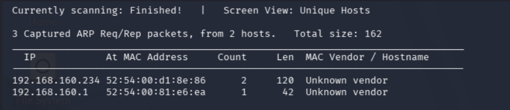

```sh
nmap -A -p- 192.168.160.234
```
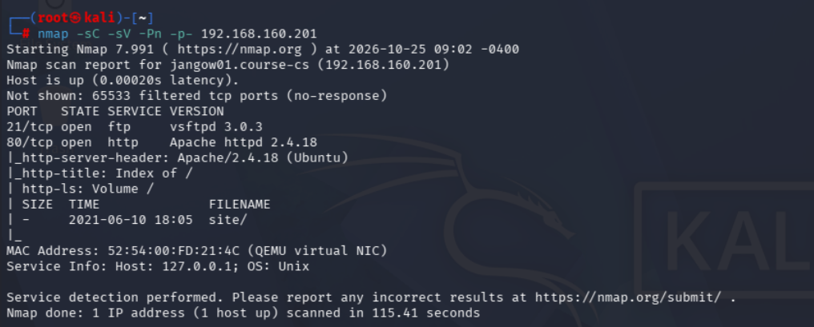

**Результат**:  
- **Port 21**: FTP (vsftpd 3.0.3)
  ftp-anon: Anonymous FTP login allowed (FTP code 230).
- **Port 22**: SSH (OpenSSH 7.9p1 Debian 10+deb10u2 (protocol 2.0)).  
- **Port 80**: HTTP (Apache httpd 2.4.38 (Debian)).  

---

### **Крок 2: Дослідження доступності системи по протоколу FTP через порт 21**
На попередньому кроці ми виявили, що сервіс ʼFTPʼ працює через порт ʼ21ʼ та дозволяє анонімний вхід. Спробуємо увійти на досліджувану машину по протоколу ʼFTPʼ. Використаємо **anonymous** як ім'я користувача та залишимо пароль порожнім. Виконаємо команди:
```sh
ftp 192.168.160.234
ls
```
**Результат**:  
Ми успішно увійшли в систему по ʼFTPʼ. Після підключення ми використали команду **ls** для перегляду вмісту каталогу.

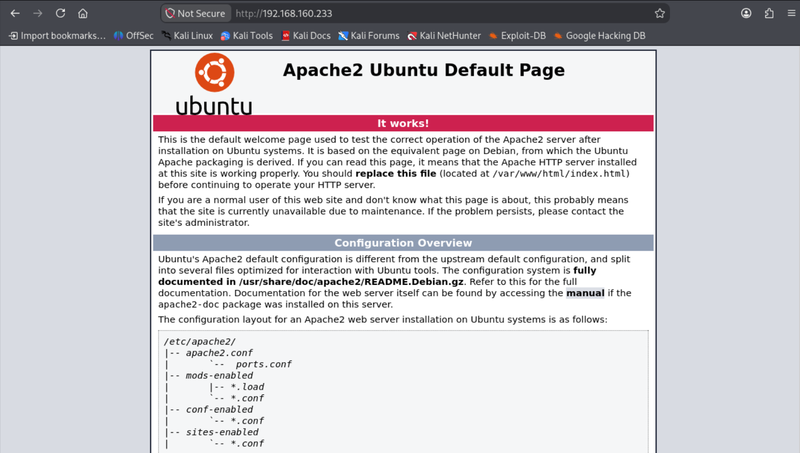

---

### **Крок 3: Скачування та дослідження графічного файлу**

На попередньому кроці ми виявили, що каталог містить файл **trytofind.jpg** розміром приблизно 1 МБ. Завантажимо його для подальшого аналізу. Використаємо команду **get**: 

```sh
get trytofind.jpg
quit
```
**Результат**:  
Ми скачали зображення в нашу ʼKaliʼ машину та вийшли з консолі ʼFTPʼ виконавши команду **quit**.

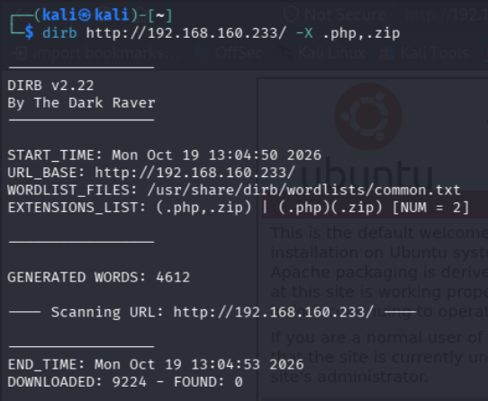

Відкриємо отримане зображення у домашній папці. Клікнимо на значку папок у верхній часнині робочого столі та виберемо ʼOpen Folderʼ. У відкритому вікні знайдемо файл **trytofind.jpg**.
Я запускав команди під рутом, тому завантажився файл у ʼ/root/trytofind.jpgʼ
```sh
find / -name "*trytofind*" 2>/dev/null
```
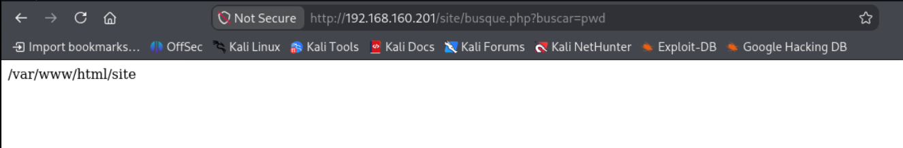
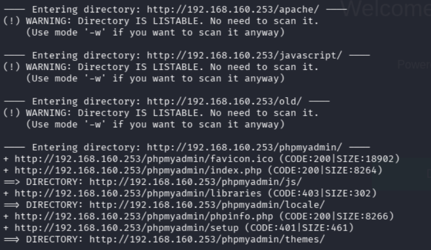

**Результат**:  
Ми змогли побачити скачане зображення кішки, яке на перший погляд виглядає не цікавим.

---

### **Крок 4: Дослідження веб-додатку на порті 80**

Відкриємо браузер та введемо IP-адресу цільової машини.

**Результат**:  
Завантажилася домашня сторінка MoneyBox http-сервіса цільової машини.

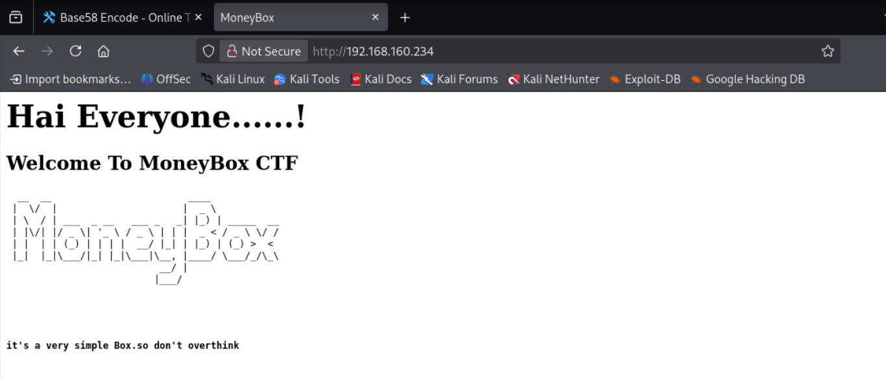

Повернемося у командну стрічку та виконаємо перебір каталогів ʼhttp-сервісаʼ (порт 80, за замовчуванням) за допомогою команди **dirb**. Виконаємо команду:
```sh
dirb http://192.168.160.234/
```
**Результат**:
Ми виявили прихований каталог **blogs**.

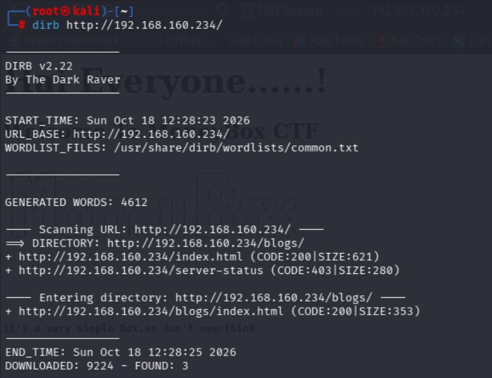

Повернемося у браузер та введемо **URL** (ʼhttp://192.168.160.234/blogs/ʼ) прихованого каталогу.

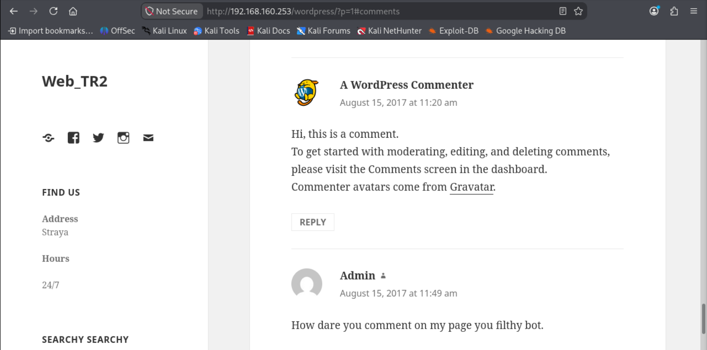

Натиснемо **Ctrl+U** та переглянемо вихідний код сторінки.

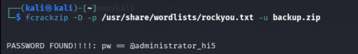

**Результат**:
Ми отримали підказку щодо іншого таємного каталогу.

На стрічці 48 ми виявили інший таємний каталог. Перевіримо його вміст. Відкриємо у браузері **URL** (ʼhttp://192.168.160.234/S3cr3t-T3xtʼ) нового прихованого каталогу.

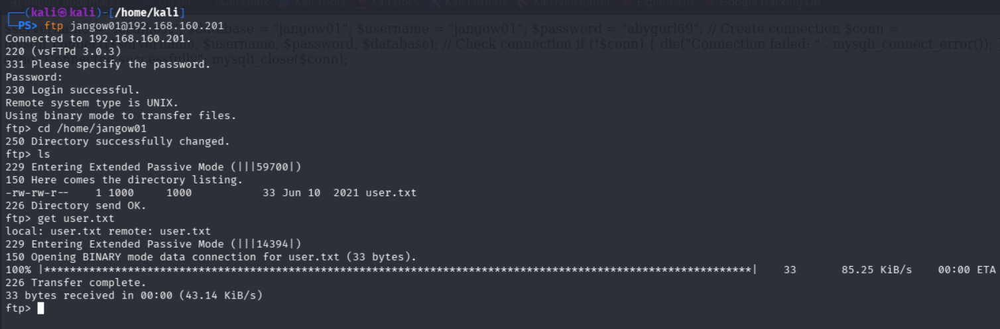

Натиснемо **Ctrl+U** та перевірмо вихідний код сторінки.

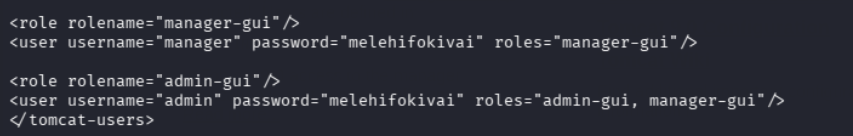

**Результат**:
- вхід на досліджувану машину по ʼFTPʼ;
- скачане зображення кота;
- ключ **3xtr4ctd4t4 — extractdata**;
- можливість залогуватися на досліджувану машину по протоколу ʼSSHʼ, але ми не можемо туди увійти, оскільки у нас немає імені користувача та пароля.

---

### **Крок 5: Аналіз зображення, отримання прихованих даних**

Дослідимо зображення кота на наявність в ньому прихованої інформації. Цей спосіб збереження даних називається стеганографією.
Якщо зображення не показує нічого очевидного, в ньому можуть бути приховані дані. Перевіримо наявність прихованих повідомлень за допомогою інструментів стеганографії. Для цього використаємо **steghide** — популярний інструмент стеганографії, який дозволяє приховувати та витягувати дані у зображеннях та аудіофайлах. Встановимо **steghide** за допомогою команди:
```sh
sudo apt install steghide
```
**Результат**:
Інструмент для вилучення прихованих даних встановлено.

Скористаємося наступними параметрами команди **steghide**.
- Параметер **extract** вказує **steghide* спробувати отримати будь-які приховані дані.
- Прапорець **-sf** вказує на файл, який потенційно містить приховану інформацію. В нашому випадку стеганографічним файлом є зображення **trytofind.jpg**.

Також **steghide** може запропонувати нам ввести пароль. В цьому випадку спробуємо ввести ключ 3xtr4ctd4t4. Отже виконаємо команду:
```sh
steghide extract -sf trytofind.jpg
```
**Результат**:
Наш ключ **3xtr4ctd4t4** спрацював і **steghide** повідомив нам, що приховані дані за зображенням було вилучено у файл з назвою **data.txt**.

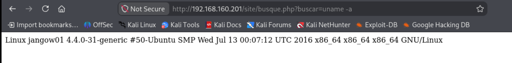

---

### **Крок 6: Аналіз отриманих прихованих даних**

Переглянемо отримані дані у файлі **data.txt**. Виконаємо команду:
```sh
cat data.txt
```
**Результат**:
Вилучене повідомлення дає нам підказку про потенційні вразливості в цільовій системі. В отриманому тексті є згадка про "занадто слабкий" пароль, який слід замінити. Повідомлення адресовано користувачу на ім'я **renu**. Це може бути дійсне ім'я користувача в системі.

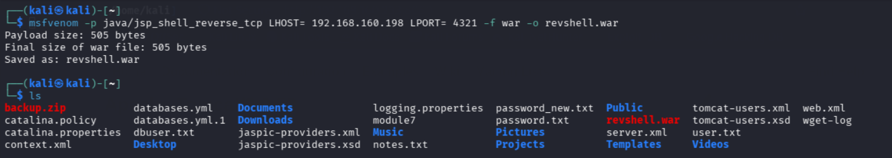

---

### **Крок 7: Підбір пароля користувача renu**

Спробуємо підібрати пароль по протоколу ssh за допомогою команди **hydra**.
Це вбудований у **Kali Linux** інструмент, який використовується в кібербезпеці та тестуванні для швидкого підбору паролів методом брутфорс (перебору) у реальному часі. Hydra підтримує понад 50 протоколів, включаючи ʼSSHʼ, ʼFTPʼ, ʼHTTPʼ, ʼHTTPSʼ, ʼSMBʼ.
Спробуємо підібрати пароль користувачу на ім'я **renu**. Скористаємося наступними параметрами команди **hydra**.
- **hydra** це команда для запуску hydra, інструменту для злому паролів методом повного перебору;
- прапорець **-l renu** вказує ім'я користувача для входу, яке буде використовуватися для атаки повним перебором; в нашому випадку це ім'я користувача **renu**;
- прапорець **-P /usr/share/wordlists/rockyou.txt** вказує шлях до файлу зі списком паролів, який hydra використовуватиме для атаки; ми використовуємо **rockyou.txt**, який є популярним списком слів, що часто використовується для злому паролів;
- параметр **-f** вказує hydra зупинитися після першого успішного входу;
- параметр **192.168.160.234** задає цільову IP-адресу для служби ʼSSHʼ;
- параметр **ssh** вказує на протокол, по якому відбуватиметься вхід.
```sh
hydra -l renu -P /usr/share/wordlists/rockyou.txt -f 192.168.160.234 ssh .
```
**Результат**:
Ми отримали пароль **987654321** користувача **renu**.

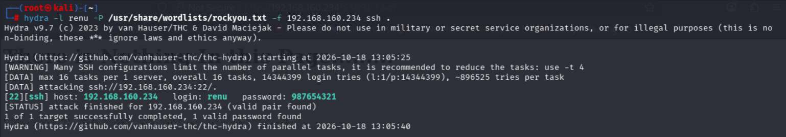

---

### **Крок 8: Дослідження профіля користувача renu**

На попередньому кроці ми отримали пароль користувача **renu**. Використовуючи ці облікові дані спробуємо увійти до цільової машини по протоколу ʼsshʼ. Виконаємо команду та введемо пароль **987654321**:
```sh
ssh renu@192.168.160.234
```
**Результат**:
Ми увійшли до цільової машини під користувачем **renu**. При першому вході потрібно за допомогою yes підтвердити операцію.

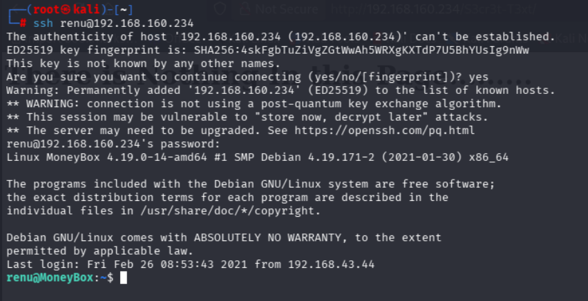

Подивимося права користувача **renu** на виконання команди **sudo**
```sh
sudo -l
```
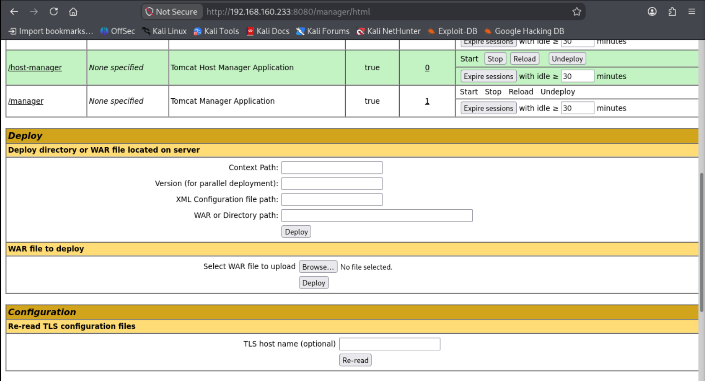

Подивимося список файлів в папці профіля користувача **renu**. Виконаємо команду:
```sh
ls -lah
```
**Результат**:
Ми отримали файли.

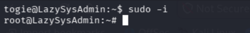

Розгянемо вміст файлу **user1.txt**. Виконаємо команду:
```sh
cat user1.txt
```
**Результат**:
Ми отримали файл з прапорцем. **us3r1{F14g:0ku74tbd3777y4}**

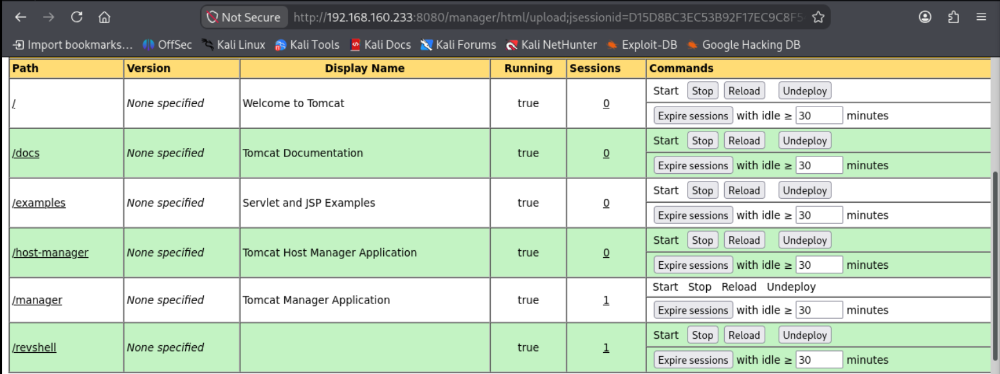

---

### **Крок 9: Дослідження файлів інших користувачів системи**

Вийдемо з домашнього каталогу користувача **renu**. Виконаємо команди:
```sh
cd ..
ls
```
**Результат**:
Ми побачили, що у системі присутній ще один користувач на ім'я **lily**.

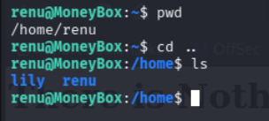

Перейдемо до каталогу **lily** та розглянемо список файлів включно з прихованими. Виконаємо команди:
```sh
cd lily
ls -lah
```
**Результат**:
З цікавого, ми отримали файл **user2.txt** та папку **.ssh**.

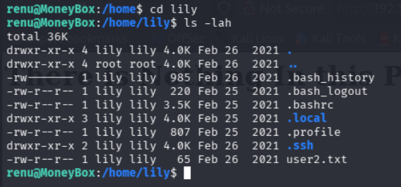

Розгянемо вміст файлу **user2.txt**. Виконаємо команду:
```sh
cat user2.txt
```
**Результат**:
Ми отримали файл з прапорцем. **us3r{F14g:tr5827r5wu6nklao}**

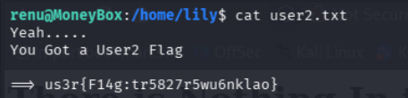

---

### **Крок 10: Дослідження потенційних шляхів для підвищення привілеїв**

В домашньому профілі користувача **lily** перейдемо до папки **.ssh** та виведемо список файлів. Виконаємо команди:
```sh
cd .ssh
ls
```
**Результат**:
У папці .ssh присутній файл authorized_keys.

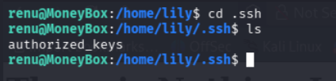

Проаналізуємо вміст файлу **authorized_keys**. Виконаємо команду:
```sh
cat authorized_keys
```
**Результат**:
У файлі **authorized_keys** зберігається публічний ключ користувача **renu**. Це означає, що користувач **renu** може залогуватися під користувачем **lily**.
```plaintext
ssh-rsa AAAAB3NzaC1yc2EAAAADAQABAAABAQDRIE9tEEbTL0A+7n+od9tCjASYAWY0XBqcqzyqb2qsNsJnBm8cBMCBNSktugtos9HY9hzSInkOzDn3RitZJXuemXCasOsM6gBctu5GDuL882dFgz962O9TvdF7JJm82eIiVrsS8YCVQq43migWs6HXJu+BNrVbcf+xq36biziQaVBy+vGbiCPpN0JTrtG449NdNZcl0FDmlm2Y6nlH42zM5hCC0HQJiBymc/I37G09VtUsaCpjiKaxZanglyb2+WLSxmJfr+EhGnWOpQv91hexXd7IdlK6hhUOff5yNxlvIVzG2VEbugtJXukMSLWk2FhnEdDLqCCHXY+1V+XEB9F3 renu@debian
```
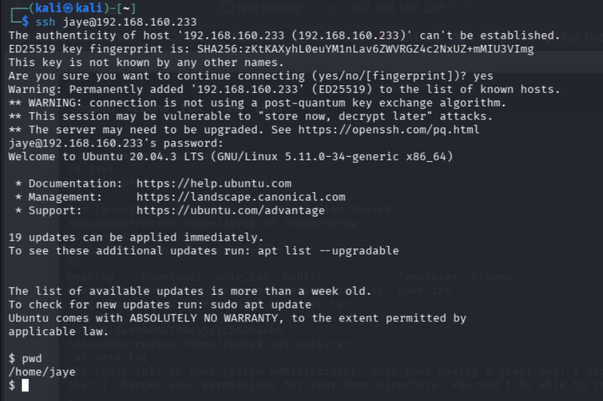

Увійдемо в систему як користувач lily використовуючи ssh. Виконаємо команду:
```sh
ssh lily@192.168.160.234
```
**Результат**:
Ми увійшли в цільову систему по протоколу ʼsshʼ як **lily** без введення пароля. При першому вході вводимо **yes** для підтвердження операції.

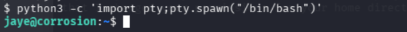

Перевіримо права на виконання команди **sudo**. Виконаємо команду:
```sh
sudo -l
```
**Результат**:
Ми побачили, що користувач **lily** має права **sudo** і може виконувати команди **perl** від імені **root** без введення пароля: **/usr/bin/perl**

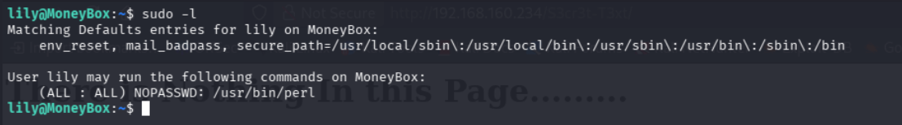

Виконаємо команду **perl** з наступними параметрами:
- утиліта **sudo** виконує команду з правами **root**;
- параметр **perl -e** вказує на необхідність виконати код на мові **Perl**, який буде наданий в аргументі командної стрічки;
- операція **'exec "/bin/bash";'** є кодом на мові **Perl**, який завантажує нову оболонку **/bin/bash** від імені користувача **root**. Отже виконаємо команду: 
```sh
sudo perl -e 'exec "/bin/bash";' .
```
**Результат**:
Ця команда запустила нову оболонку **bash** з правами **root**. Ми отримавши доступ до всієї системи та можемо виконувати будь-які дії. Оскільки задана директива **NOPASSWD**, то **sudo** не вимагає введення пароля користувача **lily**.

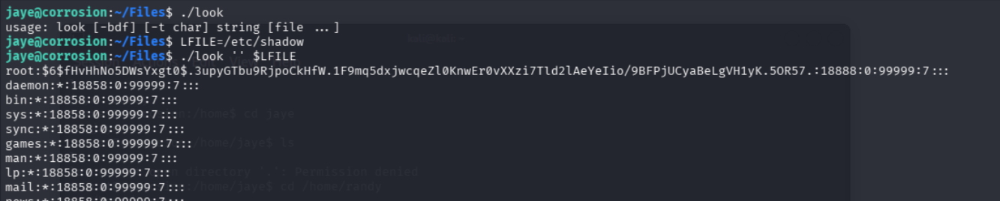

Розглянемо список файлів в профілі користувача **root**. Виконаємо команди:
```sh
cd ~
ls -lah
```
**Результат**:
У списку ми побачили приховану папку **.local** та файл **.root.txt**.

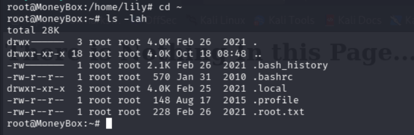

Виведемо вміст файлу **.root.txt**. Виконаємо команду:
```sh
cat .root.txt
```
**Результат**:
Ми отримали фінальний файл з прапорцем.

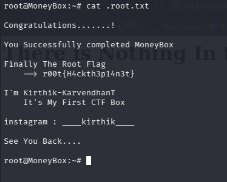

---
